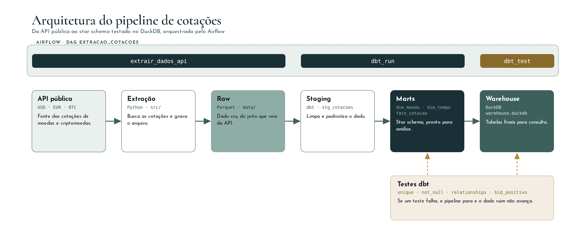

# Pipeline de Cotações

Pipeline de dados que extrai cotações de moedas e criptomoedas (USD, EUR, BTC) de uma API pública, transforma o dado em um **star schema** com **dbt**, valida com testes automáticos e guarda o resultado em **DuckDB**. A orquestração é feita com **Airflow**, rodando em **Docker**.

## Como o dado flui

```
API pública  →  Extração (Python)  →  Raw (Parquet)  →  dbt: staging  →  dbt: marts  →  DuckDB
                                                                              ↑
                                                              testes dbt validam cada carga
```



## Tecnologias

| Ferramenta | Para que serve |
|---|---|
| Python | Extração dos dados da API |
| Parquet | Camada raw (dado cru, em formato colunar) |
| Airflow | Orquestração: define a ordem das tarefas e roda tudo sozinho |
| dbt (dbt-duckdb) | Transformação em SQL versionado, testes e documentação |
| DuckDB | Banco analítico local onde ficam as tabelas finais |
| Docker | Ambiente reproduzível |

## Modelo de dados

O dado é organizado em um star schema:

| Modelo | Camada | Descrição |
|---|---|---|
| `stg_cotacoes` | staging | Dado limpo e padronizado, a partir do Parquet |
| `dim_moeda` | mart | Dimensão de pares de moeda |
| `dim_tempo` | mart | Dimensão de tempo |
| `fato_cotacao` | mart | Fato de cotações (granularidade: par de moeda × instante) |

## Qualidade de dados

Os testes do dbt rodam depois de cada transformação. Se um teste falha, o pipeline para e o dado ruim não avança.

- **Chaves:** `unique` e `not_null` nas chaves das dimensões
- **Integridade:** `relationships` entre o fato e as dimensões
- **Regra de negócio:** teste próprio (`bid_positivo`) que falha se existir cotação com `bid <= 0`

## Pipeline no Airflow

A DAG `extracao_cotacoes` tem três tarefas, nesta ordem:

```
extrair_dados_api  →  dbt_run  →  dbt_test
```

1. `extrair_dados_api`: busca as cotações na API e grava o Parquet
2. `dbt_run`: constrói as tabelas do star schema
3. `dbt_test`: valida o resultado

## Estrutura do repositório

```
dags/               DAGs do Airflow
dbt/                projeto dbt: modelos, testes e documentação
docs/               diagrama de arquitetura
src/                scripts de extração
requirements.txt    dependências Python
data/               gerada automaticamente (Parquet e warehouse.duckdb); fora do git
```

## Como rodar

**Pré-requisitos:** Docker Desktop e Git.

1. Clone o repositório:

   ```bash
   git clone https://github.com/marcoscaval/pipeline-cotacoes.git
   cd pipeline-cotacoes
   ```

2. Suba o Airflow:

   ```bash
   docker compose up -d
   ```

3. Abra o Airflow em <http://localhost:8080> e entre com `airflow` / `airflow`.
   Essas credenciais são o padrão do ambiente local e servem **apenas** para uso local.

4. Ative a DAG `extracao_cotacoes` e dispare uma execução.

5. Ao final, o resultado fica em `data/warehouse.duckdb`.

## Autor

Marcos Cavalcanti · [GitHub](https://github.com/marcoscaval)
